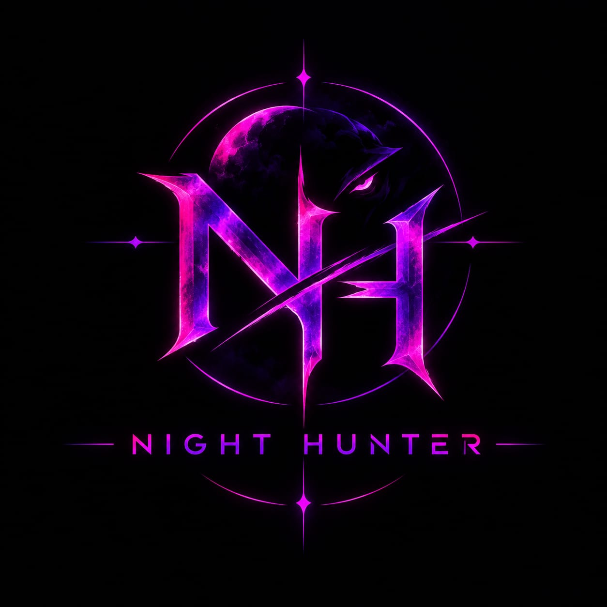

# NIGHT HUNTER

<p align="center">
  
</p>

<p align="center">
  <strong>Defensive Security & Threat Intelligence Command Center • v1.7.0</strong><br />
  <em>Auditing • Target Reconnaissance • Phishing Defense • Cryptographic Verification</em>
</p>

<p align="center">
  <a href="https://night-hunter-0br7.onrender.com"></a>
  <a href="LICENSE"></a>
  <a href="#"></a>
  <a href="#"></a>
  <a href="#"></a>
</p>

---

## Overview

**Night Hunter** is an all-in-one defensive security platform built from the ground up for cybersecurity researchers, SOC defenders, ethical auditors, and developers. It consolidates five critical security disciplines into a single cyberpunk command center:

1. **Phishing & Scam Threat Intelligence** — 653+ keyword weighted heuristics, 60+ defended brand identities, 2,412 live phishing URL cross-references, IDN homoglyphs & Levenshtein typosquatting detection.
2. **Web Security & Domain Intelligence** — TLS handshake audit, security response headers (CSP, HSTS, XFO), cookie security flags, DNS SPF/DMARC analysis, and SSRF cloud protection.
3. **Network Reconnaissance & Port Auditing** — Real asynchronous TCP socket probes across all 65,535 ports, Nmap OS fingerprinting, PTR reverse DNS, and egress firewall scoring.
4. **Credential & Password Security** — Shannon entropy evaluation, pattern/l33tspeak detection, brute-force crack time estimation, and CSPRNG password generation.
5. **Cryptography & Cryptanalysis Suite** — 10 simultaneous hash digests (MD5, SHA-1, SHA-256, SHA-512, bcrypt), unknown hash identifier, JWT decoder, and classical cipher tools.

> **Official Live Cloud Deployment:** [night-hunter-0br7.onrender.com](https://night-hunter-0br7.onrender.com)  
> **Setup and User Guide:** [USER_GUIDE.md](USER_GUIDE.md)

---

## Key Benchmarks & Verifiable Metrics

| Metric | Measured Result | Benchmark Verification |
|---|---|---|
| **Automated Test Suite** | **14 / 14 Passing** | Full pytest suite including advanced typosquatting and input validation |
| **Detection Precision** | **100.0%** | Zero false alarms across 60 legitimate enterprise / banking test messages |
| **Model Recall** | **90.0%** | 54 of 60 real-world scam vectors correctly classified |
| **F1-Score** | **89.9%** | Harmonic mean benchmarked on a 120-message empirical evaluation set |
| **False Positive Rate** | **0.00%** | 0 of 60 benign messages falsely flagged |
| **Threat Intelligence Feed** | **2,412 URLs** | Real-time active phishing indicators from verified threat databases |
| **Indian & Global Brands** | **60+ Brands** | Defended against homoglyph spoofing (SBI, HDFC, Paytm, PayPal, Google, Amazon, etc.) |

*Note: Night Hunter's phishing classifier is a rule-based triage engine benchmarked on our 120-message evaluation dataset. Results can differ on unseen messages — findings serve as defensive decision support.*

---

## 1-Click Downloads & Platform Support

Night Hunter is architected for zero-setup execution across all major platforms:

| Platform | Download Package | Run Method |
|---|---|---|
| **Windows 10 / 11 (.exe)** | [`NightHunter.exe`](releases/NightHunter.exe) | Single-file executable — double-click to launch (No Python required) |
| **Windows (.zip)** | [`night-hunter-windows.zip`](releases/night-hunter-windows.zip) | Extract and double-click `start_night_hunter.bat` |
| **Linux (Kali / Ubuntu / Debian / Arch)** | [`night-hunter-linux.tar.gz`](releases/night-hunter-linux.tar.gz) | `tar -xzf night-hunter-linux.tar.gz && ./night-hunter-linux/run.sh` |
| **Android (Termux)** | [`night-hunter-termux.zip`](releases/night-hunter-termux.zip) | Unzip and run `bash termux-install.sh`, then type `NightHunter` |
| **Cloud Dashboard** | [Direct Web Access](https://night-hunter-0br7.onrender.com) | Zero installation — runs in any modern browser |

All release packages have cryptographic checksums recorded in [`SHA256SUMS`](SHA256SUMS).

---

## Quick Start (Run from Source)

```bash
# 1. Clone the repository
git clone https://github.com/ArnabHalder-CS/Night-Hunter.git
cd Night-Hunter

# 2. Install dependencies
pip install -r requirement.txt

# 3. Launch Desktop & Web Dashboard (Port 5000)
python main.py

# 4. OR Launch Headless Terminal CLI
python main.py --cli
```

---

## The Night Hunter Advantage

| Feature | Fragmented Tools | The Night Hunter Advantage |
|---|---|---|
| **Accuracy** | Toy data & simulated progress bars | **Real active scanning** via native sockets & Nmap with genuine OS fingerprinting |
| **Workflow** | Juggling 5 different terminal windows | **Unified Single Pane of Glass** combining Web, Network, Phishing, Passwords & Crypto |
| **Phishing Safety** | Dangerous remote fetches executing scripts | **Zero-Risk Passive Inspection** analyzing homoglyphs & brand spoofs entirely offline |
| **Portability** | Dependency hell & broken virtualenvs | **1-Click direct `.exe`**, 1-command Kali installer, or Android Termux on the go |
| **Security Engineering** | Exposed commands & arbitrary injection | **Hardened against option injection** (`safe_host()`), SSRF protected, `shell=False` |
| **Reporting** | Manual screenshot taking | **1-Click Executive Reports** in HTML (with charts), JSON for SIEM, and TXT |

---

## Core Modules & Capabilities

### 1. Phishing & Social Engineering Defense (Flagship)
* **SMS & Message Scam Classifier**: Real-time weighted evaluation of 653+ scam terms covering UPI fraud, fake electricity cuts, digital arrest threats, KYC expiry, and courier parcel traps. Handles mixed Hinglish texts.
* **Passive URL Threat Analyzer**: Parses URLs without connecting to the remote host. Inspects IDN Punycode (`xn--`), mixed-script Unicode homoglyphs (e.g. Cyrillic `а` vs Latin `a`), and Damerau-Levenshtein brand proximity.
* **MITRE ATT&CK Mapping**: Generates structured ATT&CK profiles (e.g., T1566.002 Spearphishing Link) for integration into SIEM and SOC workflows.

### 2. Web Security Intelligence
* **Passive Web Audit**: Checks TLS/SSL certificate lifecycle and protocols, audits HTTP headers (CSP, HSTS, X-Frame-Options), cookie attributes (`HttpOnly`, `Secure`, `SameSite`), and DNS mail records (SPF, DMARC, MX).
* **Cloud Abuse Guard**: Enforces SSRF defense on public deployments by restricting scans to routable public IPs (blocks `127.0.0.1`, `169.254.169.254`, and private subnets).
* **Local Scanner Hub**: Seamlessly interfaces with locally installed industry scanners:
  * **Nikto**: Server misconfigurations and file leaks.
  * **Nuclei**: Community CVE and misconfiguration templates.
  * **OpenVAS / Greenbone**: Comprehensive network vulnerability auditing via `gvm-cli`.

### 3. Network Reconnaissance & Perimeter Audit
* **Full Spectrum Port Scanner**: Multi-threaded asynchronous socket engine scanning up to 65,535 ports with reverse DNS PTR resolution.
* **Network Perimeter Defense**: Tests outbound egress filtering, evaluates gateway configuration, and computes a numerical defense posture score.
* **Input Injection Protection**: Strict input validation prevents option injection (e.g. `--script=http-vuln`, `-f`, `; rm -rf /`) from reaching system-level subprocess calls.

### 4. Cryptography & Password Suite
* **Simultaneous Multi-Hash Engine**: Computes 10+ standard digests simultaneously (MD5, SHA-1, SHA-224, SHA-256, SHA-384, SHA-512, bcrypt) with instant verification.
* **Password Strength & Entropy**: Calculates Shannon entropy bits, warns of dictionary matches and l33tspeak, and estimates crack time.
* **JWT Analyzer & Classical Ciphers**: Decodes JWT headers and payloads safely; provides encoders/decoders for Base64, Hex, Caesar, Vigenère, and ROT13.

### 5. Reporting & Auditing Engine
* **Executive HTML Reports**: Styled dark cyberpunk summary reports with high-contrast vulnerability breakdowns.
* **Machine-Readable JSON**: Clean JSON schemas ready for automated SIEM ingestion and CI/CD security gates.
* **Atomic Storage**: Activity history writes use thread locks and atomic OS-level file replacements to prevent data corruption.

---

## Testing & Quality Assurance

Run the automated test suite directly:

```bash
python -m pytest tests/ -v
```

All 14 tests pass cleanly:
* `tests/test_scam_analyzer.py` — Benchmark metrics, known scam classification, legitimate message verification, Hinglish processing (6 tests)
* `tests/test_scam_analyzer_extended.py` — 120-message empirical evaluation dataset benchmark (1 test)
* `tests/test_url_phishing_advanced.py` — Combosquatting, fuzzy typosquatting, leetspeak, MITRE profile generation, official domain verification (5 tests)
* `tests/test_validators.py` — Option injection defense and hostname sanitization (2 tests)

---

## Security & Ethical Use Notice

* **Defensive Purpose Only**: Night Hunter is engineered for defensive auditing, educational threat analysis, and authorized systems administration.
* **Operator Responsibility**: The operator assumes full civil and legal responsibility for audits conducted with this tool.
* **Zero Malicious Code**: Contains zero exploits, malware, or weaponized payloads. Validated against GitHub and industry secret/malware scanner specifications.

---

## License

This project is licensed under the [MIT License](LICENSE) — see the LICENSE file for details.
